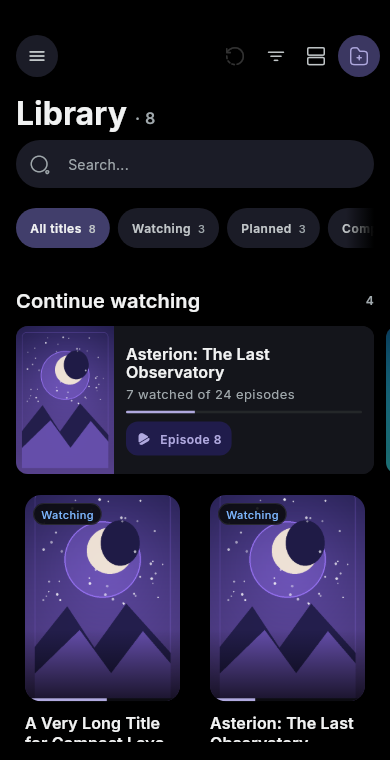
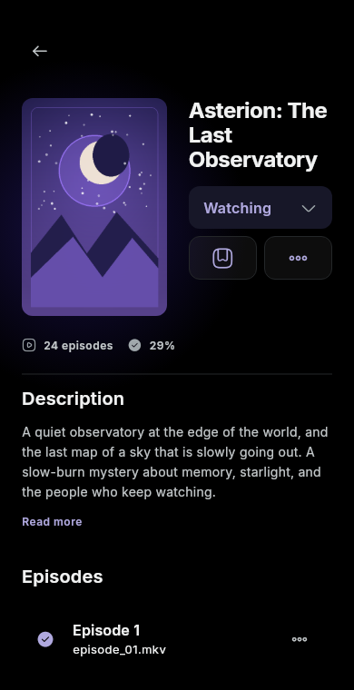
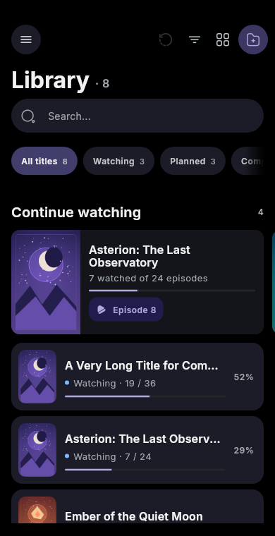
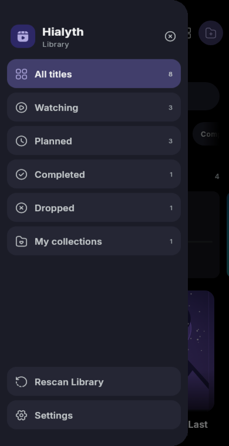

<h1 align="center">Hialyth</h1>

<p align="center">
  <b>A local-first anime library and player for Android.</b><br>
  Flutter · MediaKit / libmpv · Isar · Riverpod
</p>

<p align="center">
  <a href="https://github.com/CogitaiO/hialyth/releases/latest">
    
  </a>
  <a href="https://github.com/CogitaiO/hialyth/actions/workflows/android-ci.yml">
    
  </a>
  <a href="LICENSE">
    
  </a>
  
</p>

<p align="center">
  <b>English</b> · <a href="README.ru.md">Русский</a>
</p>

Hialyth is a Flutter app for organizing and watching a local anime collection. Point it at a folder, and it builds a library with poster art, episode progress, collections, search, and a player. The library and videos stay on your device; Shikimori and AniSkip are optional online extras for metadata and opening/ending timestamps.

> Hialyth was formerly called **Nekaido**. Some package names and storage paths (`nekaido_pre`, `NekaidoLogs`) intentionally keep the old name; a future rename will handle them separately.

## Screenshots

<table>
  <tr>
    <td align="center" width="50%">
      <br>
      <sub><b>Library</b> — artwork-led accents, filters and continue watching.</sub>
    </td>
    <td align="center" width="50%">
      <br>
      <sub><b>Title details</b> — poster, status, description and episodes.</sub>
    </td>
  </tr>
  <tr>
    <td align="center" width="50%">
      <br>
      <sub><b>List view</b> — compact rows with episode progress.</sub>
    </td>
    <td align="center" width="50%">
      <br>
      <sub><b>Navigation</b> — pull from the left half of the screen.</sub>
    </td>
  </tr>
</table>

## Highlights

- **Local-first.** Hialyth indexes the folders you choose and never uploads or deletes your videos. Metadata, progress, collections, and settings live in a local Isar database.
- **Made for a phone.** True-black surfaces, a collapsing library header, thumb-sized controls, and a navigation drawer you can pull from anywhere in the left half of the screen.
- **Artwork-led.** Accent colors are drawn from the current poster. When a poster is missing, Hialyth creates a deterministic tinted placeholder from the title.
- **A player, not a launcher.** MediaKit / libmpv playback with audio and subtitle tracks, resumable progress, next-episode flow, picture-in-picture, and automatic OP/ED skipping through AniSkip.
- **A poster you can pick up.** On mobile, drag a corner of the title poster to lift, rotate, and settle it back into place. The gesture is disabled on desktop and when Reduce motion is on.
- **Your library, your shape.** Search, status filters, collections, sorting, and a remembered grid/list preference.

## Features

### Library

- Add folders with the system folder picker; scan `.mkv`, `.mp4`, and `.avi` files.
- Match titles against Shikimori for descriptions and poster URLs when a connection is available.
- Track watching, planned, completed, and dropped titles; create collections.
- Continue watching with saved positions and per-episode progress.
- Rescan saved folders on demand. Opening the app does not start a scan automatically.

### Playback

- Local playback through MediaKit / libmpv.
- Audio and subtitle track selection.
- Episode notes and progress saved back to Isar.
- Automatic opening/ending skip when AniSkip returns timestamps.
- Next-episode prompt and picture-in-picture.

### Interface

- AMOLED-friendly black surfaces with artwork-derived accents.
- Collapsing library header with pinned status filters.
- Left navigation drawer with a wide swipe zone; Android's system Back edge stays free.
- Grid and list layouts, search, sorting, and reduced-motion support.

## Download

Get the latest signed Android build from the [Releases page](https://github.com/CogitaiO/hialyth/releases/latest).

| ABI | Use it for |
|---|---|
| `arm64-v8a` | Most modern Android phones |
| `armeabi-v7a` | Older 32-bit devices |
| `x86_64` | Compatible emulators and x86 devices |

The release app uses `com.example.nekaido_pre`; debug builds use `com.example.nekaido_pre.debug` and keep separate data. Installing a release build will not pick up the debug library. Back up app data before upgrading.

## Project status

Hialyth is in active early development. Android is the primary target; Windows and Linux sources remain in the tree, but active desktop development is paused. The latest public Android release is **0.5.0**; the desktop **0.1.0** release is historical.

| Platform | Status |
|---|---|
| **Android** | Primary focus: mobile UI, local library, playback, and new releases |
| Windows | Desktop code remains, active development deferred |
| Linux | Desktop code remains, active development deferred |

See [ROADMAP.md](ROADMAP.md) for current work and [docs/android-releases.md](docs/android-releases.md) for release signing and publishing.

## Build from source

Requirements: Flutter 3.47 or newer, the Android SDK, and an Android device with USB debugging or an emulator. The Dart constraint is in [`pubspec.yaml`](pubspec.yaml).

```bash
flutter pub get
flutter devices
flutter run -d DEVICE_ID
flutter analyze
flutter test
flutter build apk --debug
```

The debug APK is written to `build/app/outputs/flutter-apk/app-debug.apk`. Release builds require the project's persistent signing key; debug signing is not substituted for release signing. See [docs/android-releases.md](docs/android-releases.md) for the release workflow and secrets.

After changing `lib/domain/anime.dart`, regenerate the Isar model:

```bash
dart run build_runner build --delete-conflicting-outputs
```

## Tech stack

- **Flutter / Dart** with Material 3 and a custom token/theme layer.
- **MediaKit / libmpv** for playback.
- **Isar Community** for the local library and progress.
- **Riverpod** for state management.
- **Shikimori** for optional metadata and **AniSkip** for optional OP/ED timestamps.
- **Iconsax** icon set and locally bundled Inter / JetBrains Mono fonts.

## Documentation

- [Roadmap](ROADMAP.md)
- [Android releases and signing](docs/android-releases.md)
- [Design system](docs/design/design-system.md)
- [Repository map](docs/repository-map.md)
- [Showcase mode](docs/showcase.md)

Some documents are maintained in Russian; the code, commit history, and this README are the source of truth for the current implementation.

## License

Hialyth is released under the [GNU General Public License v3.0](LICENSE). Hialyth is not affiliated with Shikimori, AniSkip, or any streaming service.
