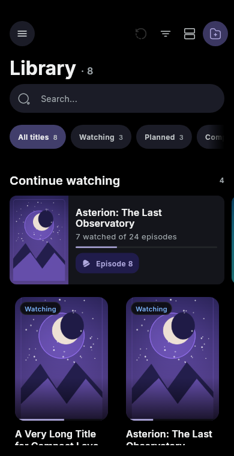
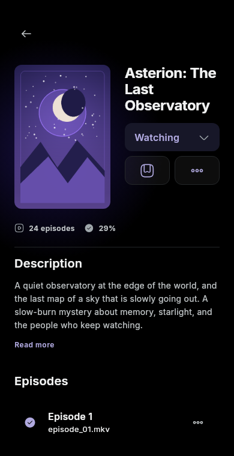
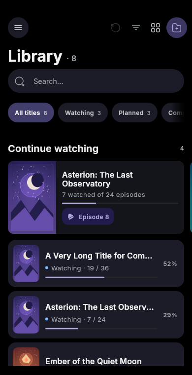
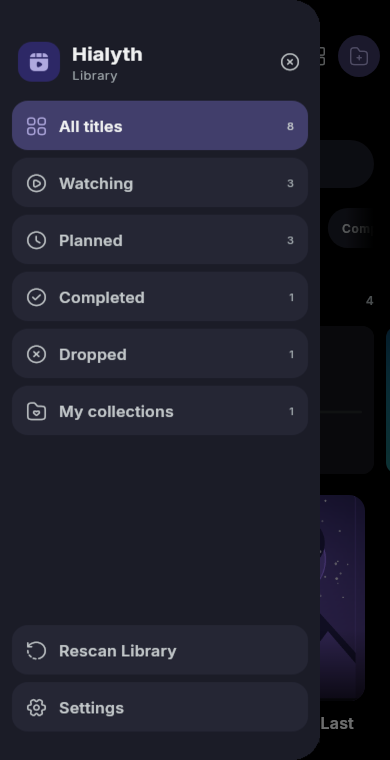

<h1 align="center">Hialyth</h1>

<p align="center">
  <b>Локальная медиатека и плеер для аниме на Android.</b><br>
  Flutter · MediaKit / libmpv · Isar · Riverpod
</p>

<p align="center">
  <a href="https://github.com/CogitaiO/hialyth/releases/latest">
    
  </a>
  <a href="https://github.com/CogitaiO/hialyth/actions/workflows/android-ci.yml">
    
  </a>
  <a href="LICENSE">
    
  </a>
  
</p>

<p align="center">
  <a href="README.md">English</a> · <b>Русский</b>
</p>

Hialyth — Flutter-приложение для организации и просмотра локальной коллекции аниме. Укажите папку, и приложение соберёт медиатеку с постерами, прогрессом эпизодов, подборками, поиском и плеером. Видео и медиатека остаются на устройстве; Shikimori и AniSkip — необязательные сетевые дополнения для метаданных и таймкодов опенингов/эндингов.

> Раньше проект назывался **Nekaido**. Часть имён пакетов и путей хранения (`nekaido_pre`, `NekaidoLogs`) намеренно сохраняет старое название; отдельное переименование затронет их позже.

## Скриншоты

<sub>Интерфейс на скриншотах — английский.</sub>

<table>
  <tr>
    <td align="center" width="50%">
      <br>
      <sub><b>Медиатека</b> — акценты от обложек, фильтры и продолжение просмотра.</sub>
    </td>
    <td align="center" width="50%">
      <br>
      <sub><b>Экран тайтла</b> — постер, статус, описание и эпизоды.</sub>
    </td>
  </tr>
  <tr>
    <td align="center" width="50%">
      <br>
      <sub><b>Список</b> — компактные строки с прогрессом эпизодов.</sub>
    </td>
    <td align="center" width="50%">
      <br>
      <sub><b>Навигация</b> — потяните из левой половины экрана.</sub>
    </td>
  </tr>
</table>

## Главное

- **Локально по умолчанию.** Hialyth индексирует выбранные папки и не загружает и не удаляет видео. Метаданные, прогресс, подборки и настройки хранятся в локальной базе Isar.
- **Сделано для телефона.** Глубокий чёрный фон, сворачивающаяся шапка медиатеки, крупные элементы управления и боковое меню, которое открывается свайпом из левой половины экрана.
- **Акценты от обложек.** Цвет интерфейса берётся из текущего постера. Если постера нет, Hialyth строит тонированную заглушку с первой буквой названия.
- **Плеер, а не просто лаунчер.** Воспроизведение через MediaKit / libmpv, выбор аудио и субтитров, сохранение прогресса, переход к следующему эпизоду, picture-in-picture и автопропуск OP/ED через AniSkip.
- **Постер, который можно поднять.** На мобильном потяните за угол постера, чтобы приподнять, повернуть и вернуть его на место. На desktop и при включённом уменьшении движения жест отключён.
- **Медиатека под вас.** Поиск, фильтры по статусу, подборки, сортировка и запоминаемый режим сетки/списка.

## Возможности

### Медиатека

- Добавление папок через системный выбор; сканирование `.mkv`, `.mp4` и `.avi`.
- Подтягивание описаний и постеров из Shikimori при наличии интернета.
- Статусы «смотрю», «в планах», «просмотрено», «брошено» и пользовательские подборки.
- Продолжение просмотра с сохранённой позицией и прогрессом по эпизодам.
- Ручное пересканирование сохранённых папок. При запуске приложения автоматического сканирования нет.

### Воспроизведение

- Локальное воспроизведение через MediaKit / libmpv.
- Выбор аудиодорожек и субтитров.
- Заметки к эпизодам и сохранение прогресса в Isar.
- Автоматический пропуск опенингов/эндингов, если AniSkip вернул таймкоды.
- Предложение следующего эпизода и picture-in-picture.

### Интерфейс

- Чёрные поверхности для AMOLED и акценты, производные от обложек.
- Сворачивающаяся шапка медиатеки с закреплёнными фильтрами.
- Левое боковое меню с широкой зоной свайпа; системный жест «Назад» на краю остаётся свободным.
- Сетка и список, поиск, сортировка и поддержка уменьшения движения.

## Скачать

Последняя подписанная Android-сборка — на [странице релизов](https://github.com/CogitaiO/hialyth/releases/latest).

| ABI | Для чего |
|---|---|
| `arm64-v8a` | Большинство современных Android-телефонов |
| `armeabi-v7a` | Старые 32-битные устройства |
| `x86_64` | Совместимые эмуляторы и x86-устройства |

Release-приложение использует `com.example.nekaido_pre`, debug-сборка — `com.example.nekaido_pre.debug` и отдельные данные. Установка release-версии не подхватит debug-медиатеку. Перед обновлением сохраните резервную копию данных приложения.

## Состояние проекта

Hialyth активно развивается и находится на раннем этапе. Основная цель — Android; исходники Windows и Linux остаются в репозитории, но активная desktop-разработка приостановлена. Последний публичный Android-релиз — **0.5.0**; desktop-релиз **0.1.0** остаётся историческим.

| Платформа | Статус |
|---|---|
| **Android** | Основное направление: мобильный интерфейс, локальная медиатека, плеер и новые релизы |
| Windows | Код сохранён, активная разработка отложена |
| Linux | Код сохранён, активная разработка отложена |

Планы — в [ROADMAP.md](ROADMAP.md), подпись и публикация — в [docs/android-releases.md](docs/android-releases.md).

## Сборка из исходников

Нужны Flutter 3.47 или новее, Android SDK и Android-устройство с USB-отладкой либо эмулятор. Ограничение Dart указано в [`pubspec.yaml`](pubspec.yaml).

```bash
flutter pub get
flutter devices
flutter run -d DEVICE_ID
flutter analyze
flutter test
flutter build apk --debug
```

Debug APK: `build/app/outputs/flutter-apk/app-debug.apk`. Release-сборка требует постоянного ключа проекта; debug-подпись больше не используется вместо релизной. Подробности — в [docs/android-releases.md](docs/android-releases.md).

После изменения `lib/domain/anime.dart` пересоберите модель Isar:

```bash
dart run build_runner build --delete-conflicting-outputs
```

## Технологии

- **Flutter / Dart**, Material 3 и собственный слой токенов/темы.
- **MediaKit / libmpv** для воспроизведения.
- **Isar Community** для медиатеки и прогресса.
- **Riverpod** для состояния.
- **Shikimori** для метаданных и **AniSkip** для таймкодов OP/ED.
- **Iconsax**, локальные шрифты Inter и JetBrains Mono.

## Документация

- [Планы разработки](ROADMAP.md)
- [Android-релизы и подпись](docs/android-releases.md)
- [Дизайн-система](docs/design/design-system.md)
- [Карта репозитория](docs/repository-map.md)
- [Showcase-режим](docs/showcase.md)

Часть документов ведётся на русском; код, история коммитов и этот README — источник истины для текущей реализации.

## Лицензия

Hialyth распространяется по [GNU General Public License v3.0](LICENSE). Hialyth не связан с Shikimori, AniSkip или какими-либо стриминговыми сервисами.
